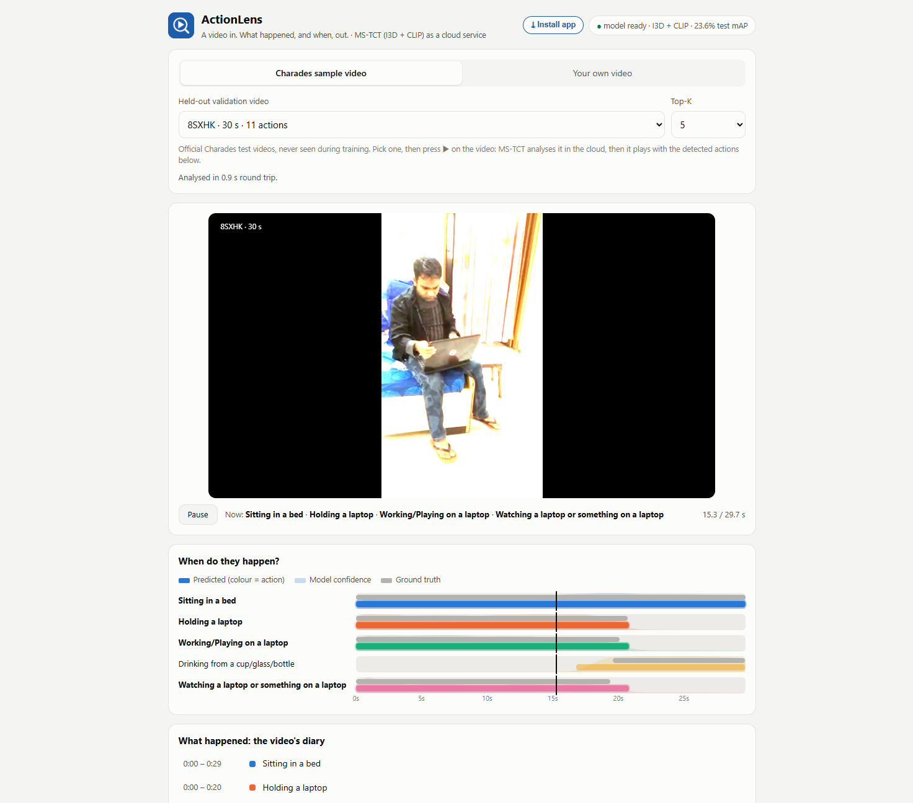
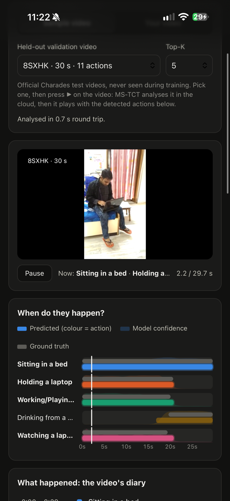
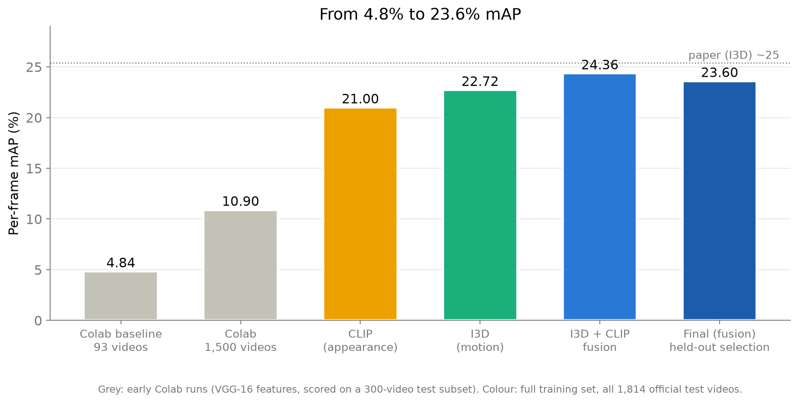
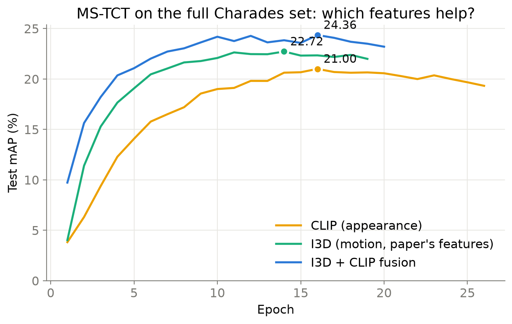
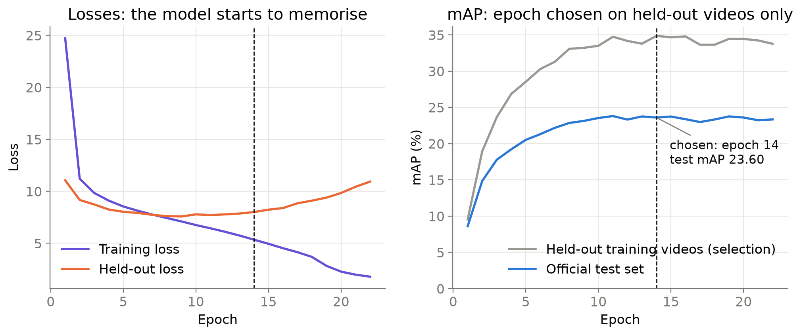
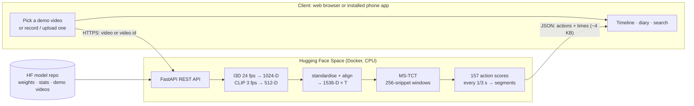
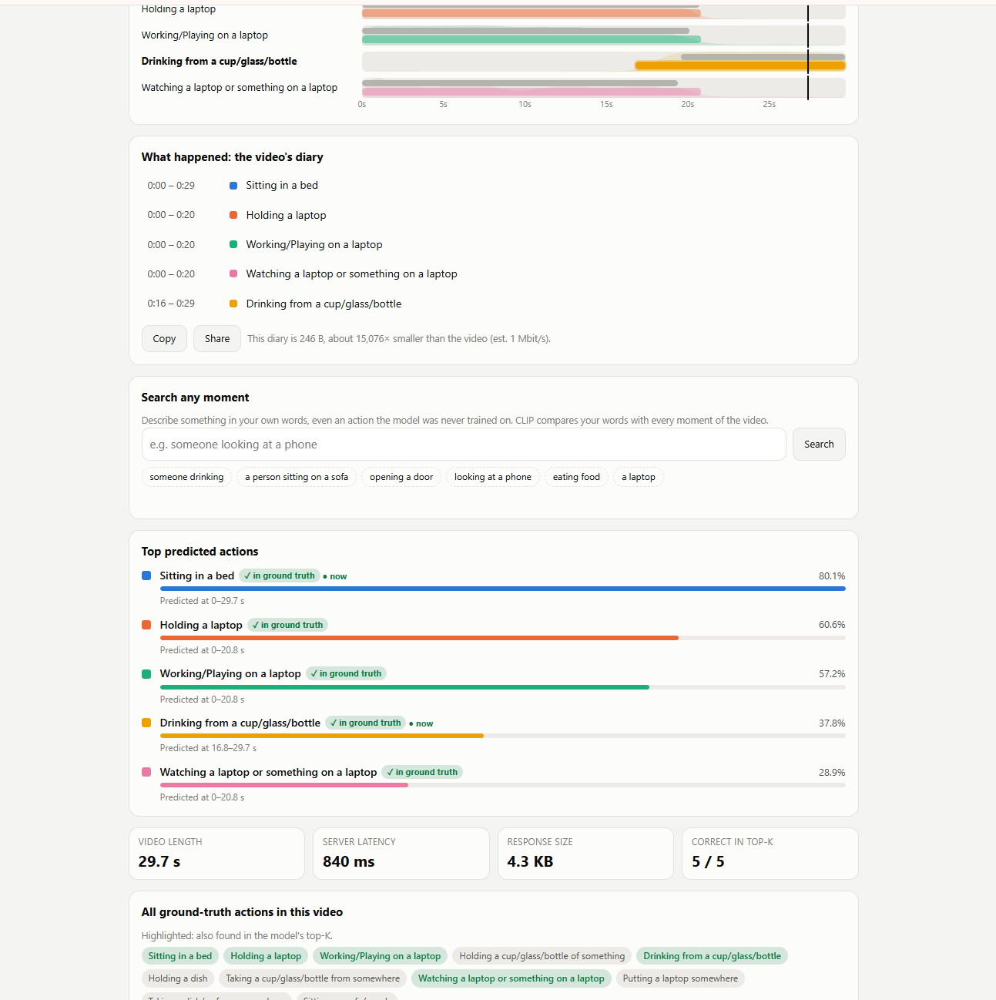
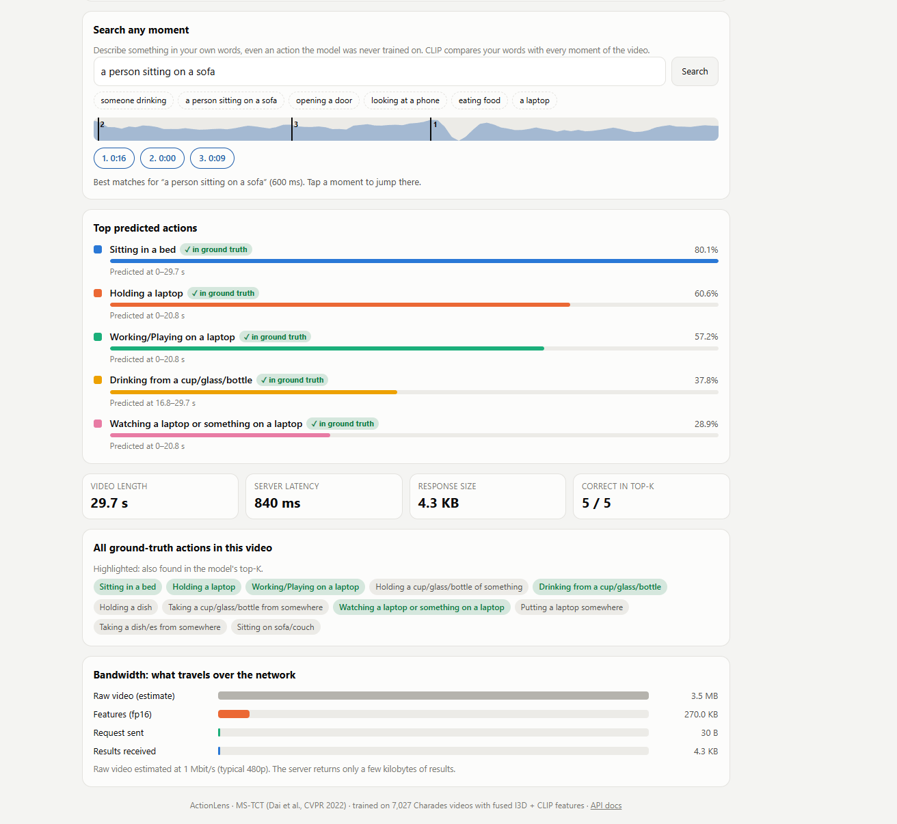

# ActionLens: temporal action detection as a cloud service

**A video in. What happened, and when, out.**

ActionLens reproduces **MS-TCT: Multi-Scale Temporal ConvTransformer for Action Detection**
(Dai et al., CVPR 2022), trains it on the full Charades dataset with our own extracted features,
and serves it as an *AI-as-a-Service* web application that also installs as a phone app.

| | |
|---|---|
| 🌐 **Live app** | https://namratha-addagada-ms-tct-action-detection.hf.space |
| 📖 **API docs** | https://namratha-addagada-ms-tct-action-detection.hf.space/docs |
| 🤗 **Model** | https://huggingface.co/namratha-addagada/ms-tct-charades-fusion |
| 📄 **Paper** | https://arxiv.org/abs/2112.03902 |
| 💻 **Original code** | https://github.com/dairui01/MS-TCT |

**Team:** Namratha Addagada, Eswar Panta · ITCS 6166 Computer Communication Networks · UNC Charlotte

<p align="center">
  
  &nbsp;
  
</p>

---

## Highlights

- **Reproduced the paper's level of accuracy.** On the official Charades test set (1,814 videos) the
  final model reaches **23.6 % per-frame mAP / 24.3 % sampled mAP**, against ~25 % reported in the
  paper with I3D features. The epoch was chosen on held-out *training* videos, never on the test set.
- **Extracted our own features** for all 9,848 Charades videos: CLIP ViT-B/32 (appearance) and
  I3D (motion, the paper's feature type).
- **Improved on the paper's I3D-only setup** by fusing motion and appearance:
  **I3D 22.72 → I3D + CLIP 24.36** mAP under identical settings.
- **Found and fixed a data bug.** About 17 % of Charades videos were recorded below 24 fps, which
  misaligned the I3D features. We detected it by checking feature lengths against video durations.
- **Tuned the "when" step.** The rule that turns scores into start/end segments was tuned on held-out
  videos: **segment F1 0.716 → 0.762** on the test set.
- **Deployed it as a service** (FastAPI in a Docker container on Hugging Face Spaces) with a web GUI
  that **installs on iPhone and Android** as a phone app (PWA), records video with the camera, writes
  a text **diary** of the video and lets you **search any moment** in plain words (CLIP).

---

## Results

All numbers are on the **official Charades test split (1,814 videos)** unless noted.

| Model | Features | Train videos | Per-frame mAP | Sampled mAP | Epoch chosen on |
|---|---|---:|---:|---:|---|
| Colab baseline (M2) | VGG-16 (Charades), 4096-D | 93 | 4.84* | – | test |
| Colab, larger subset | VGG-16 (Charades), 4096-D | 1,500 | 10.90* | – | test |
| E1 | CLIP ViT-B/32, 512-D | 7,811 | 21.00 | 21.03 | test (official code) |
| E3 | I3D RGB, 1024-D (paper's feature type) | 7,811 | 22.72 | 23.19 | test (official code) |
| E4 | **I3D + CLIP fusion, 1536-D** | 7,811 | **24.36** | **25.06** | test (official code) |
| **Final (deployed)** | **I3D + CLIP fusion, 1536-D** | 7,027 | **23.60** | **24.27** | **784 held-out training videos** |
| MS-TCT paper | I3D RGB | full | ~25.4 | – | – |

\* scored on a 300-video subset of the test split.

**Other measurements**

- Videos (15–40 s) with at least one correct action in the top 5: **92.6 %** of 1,619 test videos;
  on average **2.69 of the top 5** actions are correct.
- Segment F1 (overlap of predicted vs. true time ranges, for correctly found actions):
  **0.716 → 0.762** after tuning.
- Server latency for a demo video (features already extracted): **~0.5–0.9 s** on the free CPU.
- Response size: **~4 KB** of JSON; the text diary of a 30 s video is **~250 bytes**, against ~3.7 MB
  for the video itself at 1 Mbit/s.

<p align="center">
  <br>
  
  
</p>

---

## How it works



1. **Features.** Each video becomes one feature vector every 1/3 second: I3D (fine-tuned on Charades)
   captures *motion*, CLIP captures *appearance* (objects, scenes). Both are standardised with training
   statistics and the I3D sequence is resampled onto the CLIP time grid.
2. **MS-TCT** (official model and loss) turns the sequence into a probability for each of the
   157 actions at every snippet.
3. **Segments.** Scores are smoothed and thresholded with the tuned rule (`segment_params.json`) to
   produce start/end times. The raw confidence curve is also returned and drawn behind each bar.
4. **Search** compares a CLIP text embedding of your query with the CLIP feature of every snippet.

---

## Repository structure

```
pipeline/                 local training pipeline (run on a GPU machine)
  extract_clip_features.py   CLIP ViT-B/32 features, 3 fps, all videos
  extract_i3d_features.py    I3D features, true 24 fps (frame repetition for low-fps videos)
  check_lengths.py           verifies I3D/CLIP alignment; --delete removes mismatched files
  fuse_features.py           standardise + align + concatenate -> 1536-D
  train_clip.py              trains MS-TCT on any feature folder (official model, loss, metrics)
  make_plots.py              figures + results table from the training logs
  package_v5.py              exports the model + picks demo videos + uploads to the HF Hub
  tune_segments.py           tunes the segment rule on held-out videos, reports test F1
server/                   the cloud service (Hugging Face Docker Space)
  app.py                     FastAPI app: prediction, video upload, search
  Dockerfile, requirements.txt
  web/                       ActionLens web/phone app (index.html, manifest.json, sw.js, icons)
  deploy.py                  uploads the server to the Space
notebooks/                Colab notebooks (Milestone 2 inference, Milestone 3 deployment)
results/                  figures and results_table.csv
docs/                     screenshots
```

---

## Reproduce it

### 1. Milestone 2: inference in Google Colab
Open `notebooks/MS_TCT_Milestone2_Inference.ipynb` in Colab (GPU runtime) and run the cells in order.
It clones the official repository, fixes the issues that stop it from running on current PyTorch
(missing `mt_collate_fn` import, collate function, scheduler `verbose`, divide-by-zero in mAP, input
size 4096), converts the Charades RGB features and runs inference and training on a subset.

### 2. Full training on a local GPU (Windows, tested on an RTX 5070 Ti laptop, 12 GB)

```powershell
# environment (Python 3.12, PyTorch with CUDA 12.8)
winget install --id=astral-sh.uv -e
mkdir D:\mstct; cd D:\mstct
uv venv --python 3.12; .venv\Scripts\activate
uv pip install torch torchvision --index-url https://download.pytorch.org/whl/cu128
uv pip install open_clip_torch opencv-python timm einops pandas scikit-learn tqdm huggingface_hub matplotlib

# code + data
git clone https://github.com/dairui01/MS-TCT.git
git clone https://github.com/piergiaj/pytorch-i3d.git
curl.exe -L -C - -o Charades_v1_480.zip https://ai2-public-datasets.s3-us-west-2.amazonaws.com/charades/Charades_v1_480.zip
# copy the pipeline/*.py files into D:\mstct

# features (~25 min CLIP, ~2 h I3D)
python extract_clip_features.py
python extract_i3d_features.py
python check_lengths.py          # expect |d|<=1 for ~99.9 % of videos
python fuse_features.py

# experiments (~25-30 min each; stop with Ctrl+C after ~8 epochs without "<- best")
python train_clip.py --features D:\mstct\features_clip  --in_dim 512  --out D:\mstct\runs\clip_full
python train_clip.py --features D:\mstct\features_i3d   --in_dim 1024 --out D:\mstct\runs\i3d_v2
python train_clip.py --features D:\mstct\features_fused --in_dim 1536 --out D:\mstct\runs\fused

# final model: epoch chosen on 10 % held-out training videos, stops automatically
python train_clip.py --features D:\mstct\features_fused --in_dim 1536 --out D:\mstct\runs\fused_final --holdout 0.1 --patience 8

python make_plots.py             # figures -> D:\mstct\results
```

Settings follow the authors' `run_MSTCT_Charades.sh`: batch 32, 256 clips, Adam, lr 1e-4,
loss weights α = 1, β = 0.05, ReduceLROnPlateau.

### 3. Deploy the service

```powershell
python -c "from huggingface_hub import login; login()"   # Hugging Face token with write access
python package_v5.py        # model + demo videos -> HF model repo
python tune_segments.py     # tuned segment rule -> HF model repo
cd server; python deploy.py # server + web app -> HF Docker Space
```

The Space downloads everything it needs from the model repo given by its `MODEL_REPO` variable.
Docker Spaces require a Hugging Face PRO account; the free CPU hardware is enough.

To run the server locally instead:
`pip install torch torchvision -r server/requirements.txt`, clone MS-TCT to `/opt/MS-TCT`
(or edit the path in `app.py`), then `uvicorn app:app --port 7860` inside `server/`.

---

## API

| Method | Endpoint | Body | Returns |
|---|---|---|---|
| GET | `/api/health` | – | model info, test mAP, limits |
| GET | `/api/samples` | – | demo videos with ground-truth actions |
| POST | `/api/predict/sample` | `{"video_id": "8SXHK", "top_k": 5}` | actions, segments, confidence curves, ground truth |
| POST | `/api/predict/video` | multipart `file=<video>`, `top_k` | same, for your own video (first 30 s), plus timing per stage |
| POST | `/api/search` | `{"query": "someone drinking", "video_id": "8SXHK"}` (or `session_id`) | similarity curve + top 3 moments |
| POST | `/api/predict/features` | multipart `file=<.npy [T,1536]>` | prediction from pre-computed features |

```bash
curl -X POST https://namratha-addagada-ms-tct-action-detection.hf.space/api/predict/sample \
     -H "Content-Type: application/json" -d '{"video_id": "8SXHK", "top_k": 5}'
```

---

## Using the app

1. **Sample video:** pick an official Charades test video and press ▶. The model's actions play out
   in sync with the video; tap any bar or diary line to jump there.
2. **Your own video:** record with the camera or upload a clip (indoors, one person doing everyday
   things works best). The server extracts I3D + CLIP features itself, which takes a few tens of
   seconds on the free CPU.
3. **Diary** and **Share:** the whole video summarised as text, a few hundred bytes.
4. **Search any moment:** type a phrase, even one that is not among the 157 classes.
5. **Install as a phone app:** Android/Chrome shows *Install app*; on iPhone use
   *Share → Add to Home Screen*.

<p align="center">
  
  
</p>

---

## Limitations

- **Charades is hard:** about 6–7 overlapping actions per video, many look-alike classes, and
  crowd-sourced start/end times. Even the best published methods stay below ~30 % mAP.
- Only the **one scripted actor** is labelled in Charades, so actions of other people in the frame are
  not reported, and the model says *what* happens, not *who* does it.
- Videos unlike Charades (outdoors, sports, several people) work less well.
- One training run per setting; differences under ~0.5 mAP may be noise.
- Model selection for E1–E4 follows the official code (test set). The final, deployed number uses
  held-out training videos only.

---

## Acknowledgements

- MS-TCT model, data loader and loss: Dai et al., CVPR 2022 — https://github.com/dairui01/MS-TCT
- I3D code and Charades weights: piergiaj/pytorch-i3d (Apache-2.0)
- CLIP ViT-B/32 (OpenAI) via open_clip
- Charades dataset: Allen Institute for AI (non-commercial research use)
- Developed with help from Claude (Anthropic) as a coding assistant.
